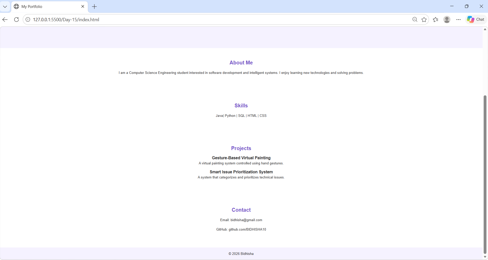

# Day 15 – Personal Portfolio Website

## Topics Covered
- HTML Structure
- CSS Styling
- Navigation Links
- Personal Portfolio Design
- Skills and Projects Sections
- Responsive Design

## Project Description
Created a personal portfolio website using HTML and CSS to showcase my profile, technical skills, projects, education and contact details.

## Technologies Used
- HTML
- CSS

## Output

